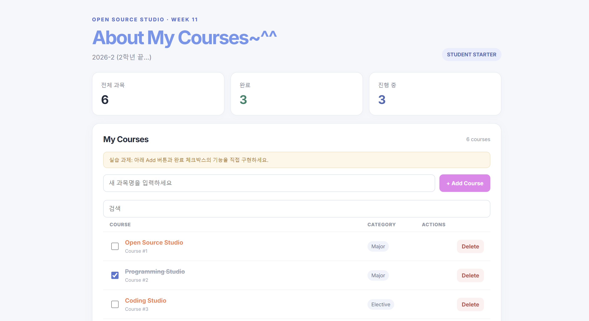

# OSS Week 11 — React Course Manager (Student Starter)

# Project Information
### 프로젝트 소개
React를 이용해서 수강하는 강의를 관리하는 웹페이지이다. 과목을 추가하거나 삭제할 수 있고, 완료 여부도 관리할 수 있다.
### 주요기능
강의을 추가하거나 삭제할 수 있고, 완료 상태로 변경도 가능하다. 전체과목, 완료, 진행 중인 강의의 수도 표시되며, 검색해서 강의를 찾을 수도 있다.
### 원본 Sample Project URL
https://github.com/2026-2-OSS/week11_sample_project


# 설치 방법 및 실행 화면
Node.js 20.19+ 또는 22.12+ 권장.
```bash
npm install
npm run dev
```  
브라우저에 표시되는 Local URL에 접속하세요. 빌드 테스트: `npm run build`.
### 실행화면


# Source Code Exploration
### Project structure
index.html은 하나만 존재하고 /src/main.jsx와 연결되어 있다.
main.jsx는 ./App.jsx와 연결되어 있다. 그리고 해당 파일은 Component인 CourseList.jsx와 연결되어 있다.
CourseList.jsx는 화면의 중간 부분, 즉 현재 상황과 배열을 나타내고 있다. (map방식으로 코드가 짜여 있다)
그리고 현재에서 변화가 생길 때마다 화면을 변경시킨다.
또다른 Component인 CourseItem도 연결이 되어 있는데 해당 파일은 완료 여부를 확인하는 파일이다.
### Component & Props : CourseList와 CourseItem의 관계 및 Props 전달 방식
CourseList는 부모이고 전체적인 과목 데이터를 관리하고 있다. CourseItem은 자식이다. 그리고 각각 과목의 정보를 화면에 표시하는 역할이다. course, onDelete, onToggle을 전달하고 있고, 버튼을 클릭했을 때 부모 component의 함수를 호출하고 있다. 이때, 부모 Component가 자식 Component에게 데이터나 함수를 전달하는 방법은 Props이다.
### State & Event: useState를 이용한 상태 관리 및 삭제 버튼의 동작 원리
courses와 newName의 상태가 관리되고 있다. courses는 전체 과목을 배열로 관리한다. newName은 새로운 과목을 입력하는 곳의 관리하고 있다. 삭제버튼은 사용자가 delete버튼을 누르면 onDelete함수가 실행되면서 해당 과목의 ID를 부모 component로 전달한다. 그럼 거기서 handleDelete함수가 실행면서 삭제 확인을 한번 더 하고, 확인을 누르면 filter를 통해 해당 ID를 제외한 새로운 배열을 생성한다. 과목 목록이 변경되면 react가 해당 부분의 화면을 다시 렌더링해서 변경된 내용을 표시하는 것이다. 
### Code Analysis: 주요 코드 2개(각 5~15줄)를 선택하여 동작 원리 설명
첫번째로는, 삭제 기능이다. useState를 통해 목록과 입력받는 것의 값을 관리한다. handleDelete 함수는 삭제할 과목의 ID를 전달받고, 삭제를 확인하면 filter를 통해 해당 ID를 제외하고 새로운 배열을 만든 후 화면을 업데이트 하는 것이다.
두번재로는, 완료 기능이다. 각 과목의 완료 값을 표시하는 체크박스이다. checked={course.completed}를 통해 과목의 완료 상태가 결정된다. 체크박스가 클릭되면 부모 component에 해당 과목의 ID가 전달된다. (onToggle(course.id)를 통해서)


# Customizing
### 과목 추가
- 파일 : courses.js
- 추가 : 오픈소스 스튜디오라는 과목
### 제목 및 설정 변경
- 파일 : App.jsx
- 변경 전 : My Course Manager, React Component, Props & State Practice
- 변경 후 : About My Courses~^^, 2026-2 (2학년 끝...)
### 스타일 변경
- 파일 : App.css
- 변경 전 1 : .hero h1은 color가 존재하지 않았다 -> color: cornflowerblue로 설정
- 변경 전 2 : .btn.primary의 background: #496fd3 -> background: violet로 설정
- 변경 3 : .course-title은 color가 존재하지 않았다 -> color : coral로 설정

# Feature Extension
### 구현한 기능 + 주요 코드 및 동작 결과
- 새로운 강의 추가 기능
사용자가 강의이름을 입력하고 Add 버튼을 누르면 새로운 강의 객체가 생성된다. 빈 문자열이 입력되는 것을 방지하기 위해 trim을 사용해꼬, setCourses를 통해서 새로운 강의을 추가하고 입력창을 초기화하는 것까지 구현하였다.
- 강의 완료 상태 기능
체크박스로 강의의 완료 상태가 변경되도록 구현하였다. 체크박스가 클릭되면 해당 강의의 ID가 전달되고, map을 이용해서 ID가 일치하는 과목을 찾아낸 후에 completed의 값을 반대로 바꾸도록 하였다. 그리고 setCourses를 통해 변경된 내용이 화면에 나타나도록 했다.
- 강의 검색 기능
useState를 이용해서 입력값을 관리하도록 했다. filter와 includes를 사용해서 검색어가 포함된 강의만 목록에 표시될 수 있도록 구현하였다.


# Deployment: 실제 접근 가능한 Vercel URL
https://week11-sample-project-two.vercel.app/

# Weekly Review
### 새롭게 배운 내용 3가지
가장 먼저 react에서 component를 이용해서 화면을 구성하고, props를 통해 부모 컴포넌트로부터 자식 컴포넌트로 데이터를 전달하는 방법을 배웠다. 그리고 데이터가 변경되면 화면에 해당 부분만 자동으로 업데이트 된다는 것을 정확하게 알게될 수 있었다. 마지막으로 map과 filter를 직접 사용해보면서 과목의 완료 상태를 변경하거나 삭제하는 방법을 배우게 되었다.
### 어려웠던 점과 해결 방법
사실 처음에는 component와 props의 관계를 이해하는 것이 어려웠다. CourseList랑 CourseItem이 어떻게 연결되어 있는지 감이 안잡혔었다. 하지만 코드를 AI와 함께 확인하면서 부모 컴포넌트가 데이터를 관리하고, 자식 컴포넌트는 전달받은 props를 이용한다는 것을 이해하게 되었다.
### AI 활용 내용 및 느낀 점
전반적인 코드를 이해하는 부분에서 AI를 활용하였다. 위에서 말한 것 같이 CourseList와 CourseItem의 관계 및 Props 전달 방식을 이해하는 부분에서 도움을 받았다. 사실 혼자했으면 정말 오래걸렸을 것 같은데 AI 덕분에 수업에서 배운 내용을 쉽게 이해할 수 있었다고 생각한다.

## 확인할 질문
- `CourseList`와 `CourseItem`의 역할은?
CourseList는 부모 컴포넌트로 전체 강의 데이터를 관리하고, CourseItem은 자식 컴포넌트로 각 강의의 정보를 화면에 표시하는 역할이다.
- 왜 `courses`를 직접 수정하지 않고 `setCourses()`를 사용할까요?
그래야지 react가 데이터 변경을 알고, 화면을 다시 렌더링하기 때문이다.
- `map()`과 `filter()`는 각각 어떤 목적인가요?
map은 각 배열 요소를 원하는 대로 변경하고 새로운 배열을 만들고, filter는 조건에 맞는 것만 선택해서 새로운 배열을 만드는 것이다.
- `course`, `onDelete`, `onToggle` Props는 어디에서 전달되나요?
부모 컴포넌트인 CourseList에서 자식 컴포넌트인 CourseItem으로 전달된다.
- 브라우저 새로고침 시 데이터가 초기화되는 이유는? (DB/localStorage 없음)
데이터를 useState로만 관리하고 있기 때문이다.

> 교육 목적의 로컬 State 앱입니다. 서버 API 및 데이터베이스는 사용하지 않습니다.
